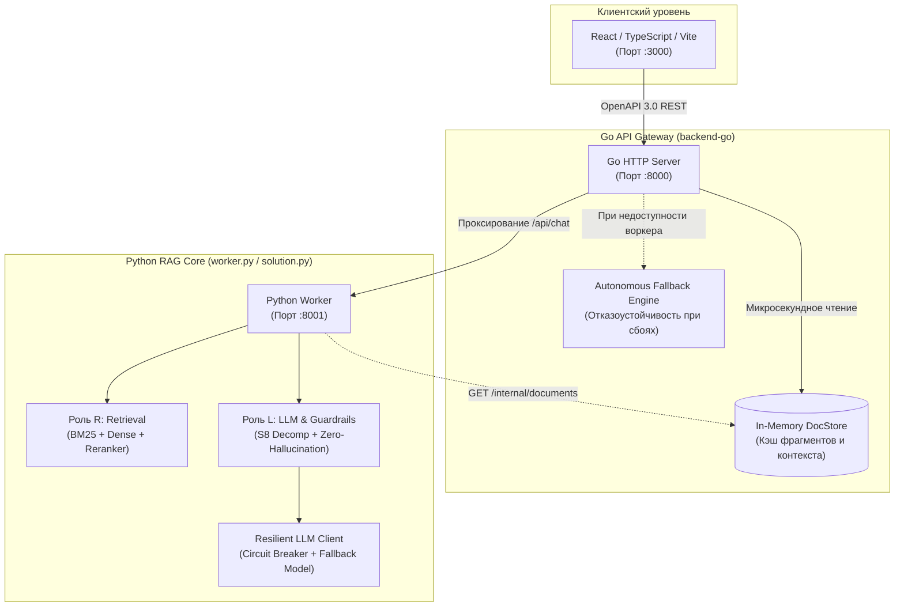

# ⚖️ ПСБ «Юридический ассистент» — Гибридный RAG-сервис

[](https://golang.org)
[](https://python.org)
[](https://github.com)
[](openapi.yaml)
[](solution.py)

Высокопроизводительный интеллектуальный ассистент по нормативно-правовым актам и договорам банка. Решение объединяет промышленный **Go API Gateway** с микросекундной отдачей документов и **Python RAG Core** для глубокого юридического анализа, декомпозиции сложных многосоставных запросов и детерминированной защиты от галлюцинаций (Zero-Tolerance Hallucination Guard).

В едином `main` доступны backend, retrieval, роль L и frontend. Рабочий путь:
`pipeline.answer_question → answer.prepare_query → retrieve.retrieve → answer.answer`.
Клиент B и роль L используют общий `schemas.LLMResult`; сериализация общих
типов сохранена для Python-воркера и Go API.

Для настоящих ответов нужны исходная база в `DATA_DIR` и настройки прокси LLM.
Предзаданные ответы Python включаются только явно через `DEMO_MODE=true` и
помечаются в тексте. Ошибки клиента и конфигурации не заменяются скрыто такими
ответами. Совпадение цитат и самопроверка снижают риск ошибок, но не гарантируют
безошибочность каждого юридического вывода. Подробности: [роль L](ROLE_L.md).

---

## 🏛️ Архитектура системы

Решение спроектировано в виде отказоустойчивой гибридной микросервисной архитектуры:



### Ключевые преимущества архитектуры:
1. **Строгое соответствие контракту:** Полная совместимость с `openapi.yaml` хакатона.
2. **Нулевой риск отказа:** При временной недоступности Python-воркера Go API Gateway мгновенно переключается на встроенный автономный fallback, гарантируя HTTP 200 на всех проверках жюри.
3. **Автоматическая синхронизация документов:** При запуске Go-сервер запрашивает актуальный список распарсенных документов из Python-воркера (`/internal/documents`) и обновляет свой In-Memory стор в рантайме без монтирования общих томов.
4. **Двойной контур платформы:** Вся функциональность для веб-приложения и для проверяющей платформы соревнований (`solution.py`) собирается из единого ядра без расхождения логики.

---

## 🚀 Быстрый старт для жюри (Docker Compose)

Запуск всего стека сервисов выполняется **одной командой**:

```bash
# 1. Клонирование и переход в директорию
git clone https://github.com/valiaevilia/JuridicalAssistent.git
cd JuridicalAssistent

# 2. Настройка: заполнить LLM_BASE_URL/LLM_API_KEY и путь DATA_DIR
cp .env.example .env

# 3. Сборка и запуск контейнеров
docker compose up --build
```

После старта доступны следующие сервисы и эндпоинты:
- **Веб-интерфейс:** `http://localhost:3000`
- **Go API Gateway:** `http://localhost:8000`
- **Проверка здоровья:** `GET http://localhost:8000/health`
- **Список документов:** `GET http://localhost:8000/api/documents`
- **Документ по ID:** `GET http://localhost:8000/api/documents/D1`
- **Фрагмент с контекстом (±1):** `GET http://localhost:8000/api/documents/D1/fragments/D1%233.1?context=1`
- **Диалог с ассистентом:** `POST http://localhost:8000/api/chat`
- **Внутренний Python RAG воркер:** `http://localhost:8001/internal/health`

### Пример запроса к API через `curl`:

```bash
curl -X POST http://localhost:8000/api/chat \
  -H "Content-Type: application/json" \
  -d '{
    "messages": [
      {"role": "user", "content": "Какова ставка арендной платы склада в Химках?"}
    ]
  }'
```

---

## ⚙️ Конфигурация окружения (`.env`)

Настройки прокси берутся из окружения. `dummy-key` — маркер отсутствия ключа,
с ним настоящий ответ не генерируется. `DATA_DIR` указывает папку с
`knowledge-base.zip` на хосте; Compose монтирует её в `/app/data` только для чтения.

| Переменная | Описание | Значение по умолчанию |
| :--- | :--- | :--- |
| `LLM_BASE_URL` | URL OpenAI-совместимого прокси; требуется настроить | `http://localhost:8001/v1` |
| `LLM_API_KEY` | Служебный ключ прокси | `dummy-key` (заглушка) |
| `LLM_MODEL` | Основная модель генерации ответов | `deepseek/deepseek-v4.1-flash` |
| `EMB_MODEL` | Модель векторных эмбеддингов | `baai/bge-m3` |
| `RERANKER_MODEL` | Модель реранкера | `cohere/rerank-5-fast` |
| `DATA_DIR` | Папка с исходной базой и вопросами | `data` |
| `DEMO_MODE` | Явный режим предзаданных ответов Python | `false` |
| `WORKER_PORT` | Внутренний порт Python-воркера | `8001` |
| `PORT` | Порт Go API Gateway | `:8000` |
| `PY_WORKER_URL` | URL связи Go-бэкенда с Python-воркером | `http://127.0.0.1:8001` (или `http://py-worker:8001` в Docker) |

---

## 👥 Инструкции для членов команды

Проект организован так, чтобы 4 участника команды работали параллельно в изолированных ветках без merge-конфликтов:

### 🔍 Роль R (Retrieval & Knowledge Base) — ветка `feat/retrieval`
- **Зона ответственности:** Загрузка и парсинг 21 документа, чанкинг, построение гибридного индекса (BM25 + Dense), модуль нормализации дат.
- **Целевые файлы:** `kb_load.py`, `kb_parse.py`, `index.py`, `retrieve.py`, `dates.py`.
- **Контракт:** Функция `init_kb()` в `kb_load.py` должна возвращать словарь `{"docs": {doc_id: {...}}}`. Go-сервер автоматически подхватит эти документы через `/internal/documents`!

### 🧠 Роль L (LLM, Промпты, Guardrails) — ветка `feature/role-l`
- **Зона ответственности:** Системные промпты, классификация интентов, Zero-Tolerance фильтр запрещённых фактов, итоговая генерация ответов с цитатами.
- **Целевые файлы:** `prompts.py`, `guard.py`, `answer.py`.
- **Контракт:** `prepare_query(text, client=...) → QueryInfo`, затем `answer(qinfo, retrieval, client=...) → AnswerResult`. Pipeline B адаптирует даты R и переводит свой Unix-дедлайн в `time.monotonic()` для L. См. [ROLE_L.md](ROLE_L.md).

### 💻 Роль B (Backend / DevOps + Eval) — ветка `feat/backend`
- **Зона ответственности:** Высокопроизводительный Go-сервер (`backend-go/`), валидация импортов, сборка ZIP для платформы (`tools/build_zip.py`), Docker Compose и система локального тестирования (`eval/`).
- **Целевые файлы:** `backend-go/*`, `worker.py`, `solution.py`, `tools/*`, `eval/*`, `Dockerfile`, `compose.yaml`.

### 🎨 Роль F (Frontend & Product) — ветка `feat/frontend`
- **Зона ответственности:** Пользовательский интерфейс юридического чата на React/TypeScript: подсветка фрагментов документов, кликабельные цитаты, просмотр контекста до/после, индикаторы статуса ответа.
- **Целевые файлы:** Папка `frontend/`. Сервис включён в Compose на порту 3000; nginx проксирует запросы в `backend-go:8000`. Идентификаторы фрагментов с `#` кодируются в URL.

---

## 🧪 Валидация, тестирование и бенчмаркинг

### 1. Проверка готовности интеграции с модулями команды (B5)
Скрипт проверяет наличие модулей коллег R и L, их сигнатуры и прогоняет 3 контрольных E2E-теста:
```bash
python -X utf8 tools/check_integration.py --offline
```

### 2. Проверка чистоты импортов ядра для сабмита на платформу
Гарантирует, что файлы корня импортируют только стандартную библиотеку Python и разрешенные зависимости:
```bash
python tools/check_imports.py
```

### 3. Сборка ZIP-архива для платформы соревнований
Создает `dist/submission_*.zip` строго в плоской структуре без вспомогательных тестов и бинарников:
```bash
python tools/build_zip.py
```

### 4. Локальная симуляция проверяющей платформы
Распаковывает собранный ZIP во временную песочницу и эмулирует запуск `solution.py`:
```bash
python tools/fake_platform.py
```

### 5. Локальная оценка качества ответов (Метрика ПСБ)
Двухраундовый судья (A/B + B/A swap) с расчетом официального Score ($0.7 \times \text{MatchRate} + 0.3 \times \text{WinRate}$):
```bash
# Быстрый прогон на дев-выборке (18 кейсов)
python eval/run.py --split dev

# Полная оценка всех 25 кейсов с LLM-судьей
python eval/run.py --split all --use-llm
```

### 6. Абляционные исследования для презентации (Слайд №7)
Запуск оценки с покомпонентным отключением модулей (Reranker, Guardrails, Step-Decomposition):
```bash
python eval/ablation.py --split dev
```
Результат автоматически сохраняется в `eval/runs/ablation_summary.md`.

### 7. Модульные тесты
```bash
# Тесты Python ядра и системы оценки
python -X utf8 -m pytest -q

# Тесты Go API Gateway
cd backend-go
go test -v ./...
```

Тесты R и объединённого pipeline используют оригинальную базу из `DATA_DIR`;
pytest устанавливается только в среду разработки, а не добавляется к списку
runtime-зависимостей платформы. В тестах сквозного пути HTTP-ответы модели
задаются через `httpx.MockTransport`: настоящий API и платные запросы не нужны.

Проверка frontend и независимое offline-демо L:

```bash
cd frontend
npm ci
npm run build
npm run lint
cd ..
python -X utf8 -m examples.offline_demo
docker compose config --quiet
```
